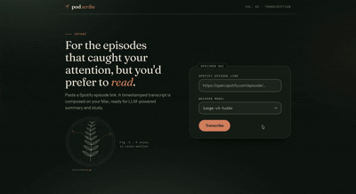

<h1 align="center">podscribe</h1>

<p align="center"><em>For the episodes that caught your attention, but you'd prefer to read.</em></p>

<p align="center"></p>

Paste a Spotify episode link. podscribe finds the show's public RSS feed, transcribes the episode **locally on your machine**, and hands you a timestamped Markdown file, ready to give to the LLM of your choice for summary and study. There is no AI analysis inside the app, no API keys, and **nothing is saved**: the audio is deleted as soon as it is transcribed, and the transcript exists only in your browser tab until you download it.

## Features

- **Any Spotify episode link.** Reads the episode title (Spotify oEmbed) and show name from Spotify's public page, finds the show's RSS feed with the free iTunes Search API, and matches the episode by title. If the match is uncertain you pick from the top three candidates. Audio is never downloaded from Spotify, only from the show's public feed.
- **Fast local transcription.** MLX Whisper on the Apple GPU by default (`large-v3-turbo`), with a faster-whisper fallback (CUDA or CPU) elsewhere.
- **Output made for LLMs.** A `.md` file with the title, show, date, duration and source link, then the `[MM:SS]` timestamped transcript, plus word and rough token counts so you can tell whether it fits your model's context window.
- **One screen, nothing saved.** A small local web app with live progress, a Cancel button, and a single download. Or use the command line.
- **Guards against invented text.** Whisper can hallucinate over silence and music; podscribe filters speech with voice-activity detection and silence checks.
- **Local only.** The web server binds to `127.0.0.1` and rejects non-localhost `Host`/`Origin` headers; outbound downloads refuse private and local addresses.

## Requirements

- **Python 3.10 or newer** (developed and tested on 3.12).
- **ffmpeg** (`brew install ffmpeg` on macOS).
- **macOS on Apple Silicon** is the tested and fastest path. See [Limitations](#limitations) for other platforms.
- A few GB of free disk for the Whisper model cache (the default model is about 1.6 GB and is downloaded once from Hugging Face on first run).

## Setup

```bash
git clone https://github.com/Ashton-Dias/podscribe.git
cd podscribe
python3 -m venv .venv && source .venv/bin/activate
pip install -r requirements.txt && pip install -e .
```

On Apple Silicon this installs `mlx-whisper` (which brings in PyTorch, so the install is large).

## Usage

### Web app

```bash
caffeinate -i podscribe web      # opens http://127.0.0.1:8000  (--port N, --no-browser)
```

1. Paste a Spotify episode link, pick a model (default `large-v3-turbo`), and click **Transcribe**.
2. Watch the stages: locating the feed, collecting the audio, transcribing. **Cancel** stops it and cleans up.
3. When it's done, click **Download .md (for your LLM)**. **New episode** starts over.

Download before you leave: refreshing or closing the tab discards the transcript. (Refreshing *during* a run just reconnects to the running job.) `caffeinate -i` keeps your Mac awake during long runs.

### Command line

```bash
podscribe "https://open.spotify.com/episode/..." [--model small|medium|large-v3|large-v3-turbo] [--feed URL] [-o FILE]
```

Prints the Markdown transcript to the terminal (progress goes to stderr), or writes it to `FILE` with `-o`. It saves nothing else. `--feed URL` searches a specific RSS feed instead of auto-discovering one.

## How it works

1. **Resolve.** Spotify title and show name, then feed discovery via iTunes Search, then fuzzy matching of the episode inside the feed (with a wrong-show filter, and a confirmation step when uncertain).
2. **Download** the MP3 from the feed into a temporary directory, with size limits and protection against requests to private addresses.
3. **Transcribe** in roughly four-minute chunks cut at silences, with voice-activity detection and cleanup of text inside silence. Progress is reported from the Whisper engine's own window-by-window progress, so the bar moves even for short episodes.
4. **Deliver.** The Markdown transcript goes to the browser once; the audio temp directory is deleted whether the job succeeds, fails or is cancelled.

Force an engine with `PODSCRIBE_ENGINE=mlx` or `PODSCRIBE_ENGINE=faster-whisper`.

## Speed

Measured on an Apple M3 with 16 GB, the same 54-minute episode and the same model:

| Engine / model | Speed | 54-minute episode |
|---|---|---|
| MLX `large-v3-turbo` (default) | about 11 to 12x real time | about 4.5 to 5 minutes |
| faster-whisper `large-v3-turbo`, CPU | about 1.6x real time | about 34 minutes |

Other models: `small`, `medium`, `large-v3`.

## Project layout

```
podscribe/
  resolve.py      Spotify link -> RSS feed -> episode (discovery and fuzzy matching)
  download.py     SSRF-guarded audio download
  net.py          outbound HTTP safety checks
  engines.py      MLX and faster-whisper engines, chunking, VAD and silence cleanup, progress hook
  transcribe.py   engine selection and progress plumbing
  pipeline.py     download -> transcribe -> in-memory result (temp audio always deleted)
  export.py       Markdown export, word and token counts
  cli.py          command line and `podscribe web`
  web/            FastAPI app, in-memory job manager, and the static UI (docs/demo.gif shows it)
tests/            pytest suite
```

## Tests

```bash
pip install -r requirements-dev.txt && pytest
```

The tests fake the network and the Whisper engines, so they run without models or internet (they do need `ffmpeg`/`ffprobe` on your PATH).

## Limitations

- **Tested end to end on macOS with Apple Silicon only.** The faster-whisper fallback for other platforms (CUDA or CPU) is covered by unit tests but has not been run end to end.
- **Spotify-exclusive podcasts can't be found**, because they have no public RSS feed. Pass `--feed URL` on the command line if you have one.
- **Matching is by title.** Very similar episode titles may ask you to confirm the right one; a brand-new episode won't be found until it appears in the show's RSS feed.
- **Transcription quality depends on the model and the audio.** Names, jargon and overlapping speakers can still be wrong.
- **Local use only.** The web app is meant for `localhost` and has no authentication. Don't expose it to a network.

## Privacy and responsible use

podscribe runs on your machine. The only network traffic is: Spotify's public oEmbed and episode page (title and show name), the iTunes Search API, the podcast's own public RSS feed and audio file, and the one-time Whisper model download from Hugging Face. No audio or transcript is uploaded anywhere, and nothing is stored after you download your file.

It is meant for personal use on episodes you have the right to listen to. You are responsible for respecting podcast creators' rights and the terms of the services involved. It never downloads audio from Spotify.

## Third-party components

- Fonts bundled under the SIL Open Font License (license files are in [`podscribe/web/static/fonts/`](podscribe/web/static/fonts)): Fraunces, Instrument Sans, IBM Plex Mono.
- Whisper models are downloaded from Hugging Face on first use under their own licenses.
- Built with FastAPI, faster-whisper, mlx-whisper, feedparser and rapidfuzz.

## License

[MIT](LICENSE) © 2026 Ashton Dias
